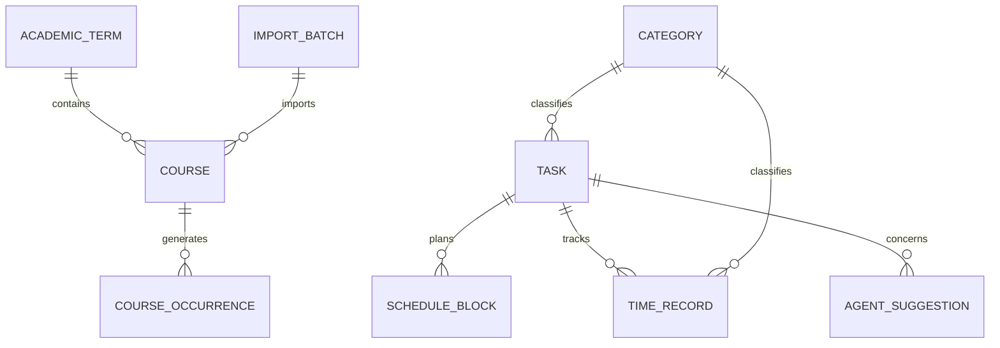
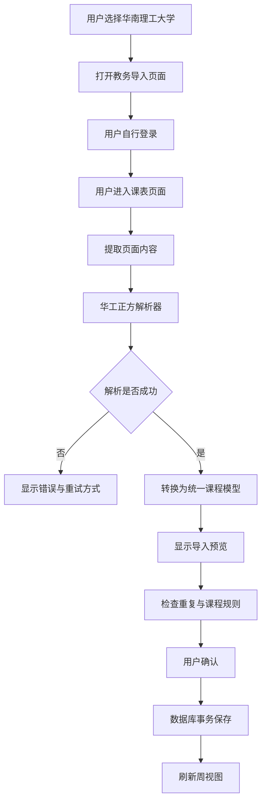
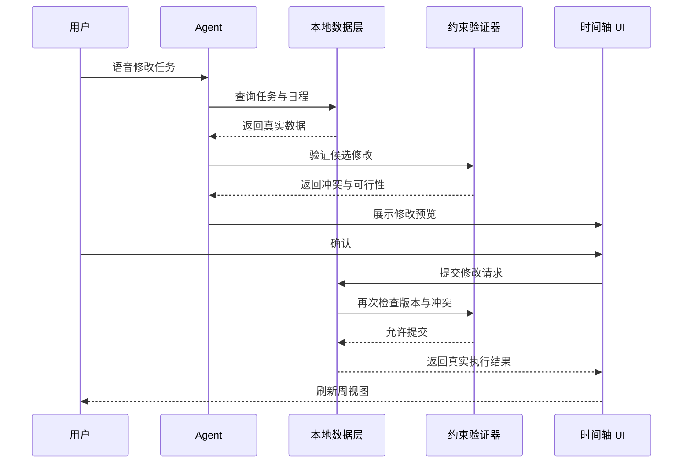
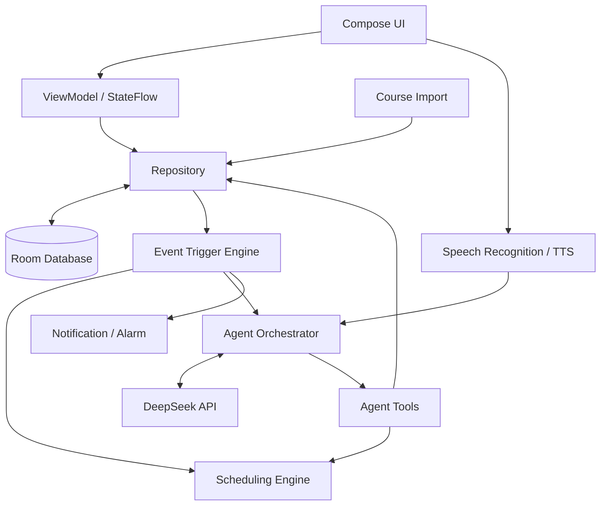

# 个人时间管理 Agent App
## MVP 产品需求与技术开发规格书

后续确认需求与交付： [第二轮 · 课表与助手](第二轮需求与开发计划.md)、[第三轮 · UI 与直接交互](第三轮UI与交互需求.md)。后续明确要求覆盖本初版中的相应约定。

**文档版本：** v0.1  
**文档状态：** 初版开发规格，待技术验证  
**产品形态：** Android 原生个人时间管理应用  
**核心技术方向：** Kotlin + Jetpack Compose + Room + DeepSeek API  
**首期目标用户：** 大学生  
**核心产品定位：** 以周时间轴为中心，统一管理课程、计划任务和实际时间记录，通过语音 Agent、事件驱动的主动建议和历史记录分析，降低日程管理成本。

**后续修订：** 2026-10-20 的已确认调整见 [第二轮需求与开发计划](第二轮需求与开发计划.md)，包括紧凑全天时间轴、连续日期滑动、双指缩放、真实 PDF 导入、分层活动模板和第一版语音助手。

---

# 0. 文档使用说明

本文档用于指导后续产品开发、代码生成、技术验证和功能验收。

在开发过程中，所有需求必须区分以下四种状态。

- **[已确认]**：已经由产品设计讨论明确决定，不应在没有新需求的情况下擅自更改。
- **[证据已确认]**：已经从现有逆向报告、项目资料或明确的技术资料中得到支持，但不代表已经在自己的 App 中实现。
- **[建议默认]**：为了让项目能够开始开发，先采用一个合理的默认方案。
- **[待验证]**：需要通过真实数据、源码检查、构建、运行或测试才能确认。

本文档不是要求开发者一次性实现所有功能，而是定义完整的产品方向、系统边界和第一版开发任务。

开发时应优先实现能够独立验收的最小闭环，再逐步扩展。

## 0.1 主要参考资料

### 用户已有的逆向资料

1. 相邻手机 Pi 工作区（未纳入本仓库）`/outputs/时间日志-REA逆向结果与限制.md`
2. 相邻手机 Pi 工作区（未纳入本仓库）`/outputs/WakeUp-编辑与周切换静态分析.md`
3. 相邻手机 Pi 工作区（未纳入本仓库）`/outputs/WakeUp-课程导入真实数据源分析.md`
4. 相邻手机 Pi 工作区（未纳入本仓库）`/outputs/WakeUp-华南理工导入配置.json`

其中，后两份文件已经提供了华南理工大学课程导入的配置和调用链分析。

### 参考开源项目

- TimePlanner：<https://github.com/v1tzor/TimePlanner>
- Android Week View：<https://github.com/tobiasschuerg/android-week-view>
- Kizitonwose Calendar：<https://github.com/kizitonwose/Calendar>
- Super Productivity：<https://github.com/super-productivity/super-productivity>
- Simple Time Tracker：<https://github.com/Razeeman/Android-SimpleTimeTracker>
- iCal4j：<https://github.com/ical4j/ical4j>
- Sherpa-ONNX：<https://github.com/k2-fsa/sherpa-onnx>
- Open Sunsama：<https://github.com/ShadowWalker2014/open-sunsama>

上述项目属于候选参考对象，不代表已经验证能够直接组合使用。最终选型必须检查当前源码、许可证、依赖版本、构建结果和实际运行情况。

---

# 1. 产品目标与设计原则

## 1.1 产品愿景

开发一个以个人时间管理为核心的 Android App。

用户打开 App 后，可以在同一个周视图中看到：

- 从学校课表导入的固定课程。
- 用户自己创建的任务和待办。
- 用户为任务安排的计划时间块。
- 实际发生的时间记录。
- Agent 提出的时间调整建议。

用户可以通过触摸界面直接操作，也可以通过语音告诉 Agent 要做什么。

Agent 不只是聊天机器人，而是能够读取应用中的真实日程数据、理解用户指令、调用业务工具、生成修改方案、检查约束，并在适当的确认机制下执行修改的时间管理助手。

长期目标是让系统根据历史执行情况逐渐提高时间估计和规划质量，但第一版不要求训练自己的基础模型，也不要求实现完整的递归自我改进系统。

## 1.2 核心产品价值

第一版主要解决四个问题。

### 问题一：时间数据分散

课程表、待办事项和时间日志往往分布在不同应用中，用户需要反复切换。

解决方案：使用统一的周视图呈现不同来源的时间数据。

### 问题二：计划与实际脱节

用户可能安排了两小时学习，但实际只学习了四十分钟。普通日历难以将计划和实际记录结合起来分析。

解决方案：计划时间块与实际时间记录独立存储，同时支持关联和对比。

### 问题三：修改日程操作繁琐

用户需要手动找到任务、打开编辑页、修改时间、检查冲突并保存。

解决方案：允许通过自然语言发出指令，由 Agent 定位任务、生成方案并完成修改。

### 问题四：传统时间管理工具缺少主动反馈

用户未必会主动检查延误、空闲时段和计划偏差。

解决方案：当发生有意义的事件时，系统根据规则检测问题，并按需提出建议。

## 1.3 产品设计原则

1. **时间轴优先**：周视图是主界面，不以聊天窗口作为首页。
2. **数据统一展示、实体独立管理**：课程和任务共同出现在时间轴中，但使用独立的数据模型。
3. **计划与实际分离**：不能用实际记录覆盖原计划。
4. **允许现实复杂性**：实际记录允许重叠；计划冲突默认提醒但允许保存。
5. **用户控制权优先**：Agent 可以提出建议，不得未经授权批量修改重要日程。
6. **本地优先**：核心数据管理不依赖大模型或网络。
7. **可验证、可撤销**：重要修改必须有执行结果、操作历史和适当的恢复机制。
8. **逐步增加智能**：先保证数据和规则正确，再增加主动规划与个性化能力。

---

# 2. 用户、场景与 MVP 范围

## 2.1 首期用户

首期面向大学生，重点使用场景包括：

- 导入一学期课程。
- 查看每天和每周的课程安排。
- 规划论文阅读、实验、复习和项目开发。
- 记录实际学习时长。
- 通过语音快速创建、查询和修改任务。
- 查看计划与实际投入的差异。
- 在任务延误或日程变化时获得调整建议。

未来可以扩展到自由职业者、个人顾问、移动办公人员、上门服务人员等，但不将这些群体作为第一版开发的主要对象。

## 2.2 MVP 必须具备的功能

| 模块               | 第一版要求                         | 优先级 |
| ------------------ | ---------------------------------- | ------ |
| 周视图             | 七天时间轴、左右切周、纵向滚动     | P0     |
| 时间块详情         | 点击查看课程、任务或记录详情       | P0     |
| 课程管理           | 导入、查看、编辑和处理重复导入     | P0     |
| 任务管理           | 创建、修改、完成、延后、删除任务   | P0     |
| 计划时间块         | 为任务安排一个或多个时间段         | P0     |
| 实际时间记录       | 开始、结束、手动补录和修改         | P0     |
| 语音 Agent         | 识别指令、调用工具、反馈结果       | P0     |
| 冲突检测           | 识别课程、计划之间的时间冲突       | P0     |
| 修改确认           | 修改预览、确认、取消和撤销         | P0     |
| 主动建议           | 由事件触发，不固定每天生成计划     | P0     |
| 统计复盘           | 计划与实际、分类投入、去重时间跨度 | P1     |
| 复杂目标系统       | 周期目标、连续打卡等               | 后续   |
| 全天候唤醒词       | 持续后台监听语音                   | 后续   |
| 跨设备同步         | 云端同步和多端冲突处理             | 后续   |
| 通用手机操作 Agent | 发送消息、打电话、操作其他 App     | 后续   |

## 2.3 第一版明确不做的事情

- 不把通用聊天机器人作为主界面。
- 不要求第一版具备 Root 权限。
- 不要求第一版自动操作微信、电话或其他第三方 App。
- 不要求第一版全天候监听麦克风。
- 不要求第一版兼容所有高校教务系统。
- 不要求第一版自动执行整天的日程重排。
- 不要求第一版训练或修改 DeepSeek 的模型权重。
- 不要求第一版实现复杂的用户行为预测。

---

# 3. 核心 UI 规格

## 3.1 页面结构

第一版采用四个主页面。

| 页面   | 职责                                           |
| ------ | ---------------------------------------------- |
| 时间轴 | 查看一周内的课程、任务、计划和实际记录         |
| 任务   | 管理所有任务、待办、优先级、截止时间和预计耗时 |
| 复盘   | 查看计划与实际差异、时间统计和历史趋势         |
| 我的   | 课程导入、偏好、通知、数据管理和 Agent 设置    |

语音 Agent 的入口应始终容易访问，但不必单独占据一个主导航位置。

## 3.2 周视图布局

**[已确认]** 主界面以周为单位，可左右滑动查看不同周。

**[建议默认]** 第一版使用周一至周日的七列布局。

纵向时间范围为 00:00–24:00，并允许上下滚动。

页面顶部显示：

- 当前浏览日期范围。
- 当前教学周次（如果已配置学期）。
- 返回本周按钮。
- 课程、计划、实际记录的图例。
- 必要的日历或更多操作入口。

页面主体显示七天的时间块。

页面底部显示语音 Agent 入口。

### 时间块显示原则

由于手机屏幕较窄，周视图不适合展示大量文字。

因此：

- 时间块默认显示简短标题。
- 根据类型使用不同颜色或边框。
- 过长的标题进行截断。
- 点击后打开详情面板。
- 重叠块可以并排或采用堆叠布局。
- 不允许因为重叠而静默隐藏真实记录。

建议使用固定的类型视觉编码：

| 类型           | 视觉表达建议 |
| -------------- | ------------ |
| 固定课程       | 蓝色系       |
| 计划任务       | 紫色系       |
| 实际记录       | 青绿色系     |
| Agent 候选修改 | 半透明预览块 |
| 存在冲突的计划 | 显示冲突标识 |

颜色只是建议默认值，最终应支持深浅色主题并确保对比度。

## 3.3 周切换逻辑

必须区分三个概念：

1. `today`：系统当前真实日期。
2. `selectedWeekStart`：用户正在浏览的周的起始日期。
3. `academicWeek`：相对于学期开始日期计算的教学周。

它们不能使用同一个状态变量代替。

例如，用户正在浏览两周前的课程时：

- 时间轴显示两周前的数据。
- 系统仍然知道今天的真实日期。
- 学期周次仍根据学期起始日期计算。

建议默认行为：

- 向左滑动：进入上一周。
- 向右滑动：进入下一周。
- 点击“本周”：返回真实当前周。
- 切换周次时，保留纵向滚动位置或按明确规则复位。
- 跨月、跨年必须正常工作。
- 如果应用重新启动，默认回到本周；是否记住上次浏览周可通过偏好设置扩展。

## 3.4 时间块点击与详情面板

点击时间块后，优先采用底部弹出面板，不强制跳转到全新页面。

详情内容根据实体类型变化。

### 课程详情

- 课程名称。
- 上课日期与时间。
- 教室。
- 教师。
- 周次、单双周。
- 课程来源。
- 是否为调课或手工修改的课程实例。

### 任务详情

- 任务名称。
- 预计耗时。
- 截止时间。
- 优先级。
- 分类、标签和备注。
- 当前状态。
- 已有计划时间块。
- 已有关联的实际记录。

### 实际时间记录详情

- 实际开始时间。
- 实际结束时间。
- 实际耗时。
- 分类。
- 标签。
- 备注。
- 是否存在重叠。
- 关联任务（可选）。

### 计划块详情

- 关联任务。
- 计划开始与结束时间。
- 计划时长。
- 是否与课程或其他计划冲突。
- 修改、删除和交给 Agent 调整的入口。

## 3.5 时间块移动

第一版建议先支持通过详情面板修改时间，而不是立即实现复杂的拖动交互。

后续增加拖动时，必须处理：

- 横向跨天移动。
- 纵向调整开始时间。
- 调整持续时间。
- 相邻时间块的触控冲突。
- 周切换与上下滚动的手势冲突。
- 修改后的冲突检测。
- 撤销操作。

拖动并不是 MVP 首期的必要条件。

---

# 4. 统一时间数据模型

## 4.1 设计目标

数据模型必须能够表达：

- 一学期的重复课程。
- 某一天实际发生的课程。
- 一个任务对应多个计划时间块。
- 一个任务对应多条实际记录。
- 没有关联任务的临时实际记录。
- 计划之间的冲突。
- 实际记录之间的重叠。
- Agent 修改前后的数据状态。

课程、任务、计划时间块和实际时间记录必须保持概念独立。

## 4.2 核心实体

### A. Course：课程定义

建议字段：

| 字段          | 类型示例 | 说明       |
| ------------- | -------- | ---------- |
| `id`          | UUID     | 主键       |
| `name`        | String   | 课程名称   |
| `teacher`     | String?  | 教师       |
| `location`    | String?  | 教室       |
| `termId`      | UUID?    | 所属学期   |
| `sourceId`    | UUID?    | 导入来源   |
| `externalKey` | String?  | 来源侧标识 |
| `createdAt`   | Instant  | 创建时间   |
| `updatedAt`   | Instant  | 更新时间   |

课程定义负责保存相对稳定的信息，不应直接用它代表每一次具体上课。

### B. CourseOccurrence：课程实例

每一次实际安排的课程对应一个实例。

建议字段：

- `id`
- `courseId`
- `date`
- `startTime`
- `endTime`
- `locationOverride`
- `teacherOverride`
- `status`
- `sourceOccurrenceKey`
- `isManuallyModified`
- `createdAt`
- `updatedAt`

状态至少包括：

- `SCHEDULED`
- `CANCELLED`
- `RESCHEDULED`

课程实例可以单独调整教室、时间或状态，而不影响整学期其他课程。

### C. AcademicTerm：学期

建议字段：

- `id`
- `name`
- `startDate`
- `endDate`
- `teachingWeekCount`
- `firstWeekStartDate`
- `timezoneId`

学期开始日期是计算教学周次的依据。

单双周和教学周范围需要通过课程规则或导入适配器转换成具体的课程实例。

### D. Task：任务

建议字段：

- `id`
- `title`
- `description`
- `estimatedMinutes`
- `dueAt`
- `priority`
- `status`
- `categoryId`
- `createdAt`
- `updatedAt`
- `completedAt`
- `source`
- `deletedAt`

状态建议包括：

- `TODO`
- `IN_PROGRESS`
- `COMPLETED`
- `CANCELLED`

任务不直接等同于一个时间段。

一个任务可以没有计划时间块，也可以拥有多个计划时间块。

### E. ScheduleBlock：计划时间块

建议字段：

- `id`
- `taskId`
- `startAt`
- `endAt`
- `status`
- `isLocked`
- `conflictStatus`
- `createdAt`
- `updatedAt`
- `version`

一个任务可以关联多个计划时间块。

计划块的修改不应覆盖实际记录。

### F. TimeRecord：实际时间记录

建议字段：

- `id`
- `taskId`，可为空
- `startAt`
- `endAt`，未结束时可为空
- `categoryId`
- `notes`
- `source`
- `createdAt`
- `updatedAt`
- `isManuallyEdited`

`source` 可以区分：

- `TIMER`
- `MANUAL`
- `VOICE`
- `IMPORTED`

实际记录允许重叠。

没有关联任务的记录可用于临时活动，例如吃饭、通勤或休息。

### G. Category：分类

建议字段：

- `id`
- `name`
- `color`
- `sortOrder`
- `isArchived`

用于学习、课程、实验、生活、娱乐等分类统计。

### H. Tag：标签

建议字段：

- `id`
- `name`
- `color`

如果需要一条记录关联多个标签，建议使用独立的关联表，而不是将所有标签拼接成字符串。

### I. Preference：用户偏好

建议包括：

- 每周起始日。
- 默认日视图时间范围。
- 默认任务缓冲时间。
- 免打扰时间。
- 主动建议模式。
- 是否启用语音回复。
- 默认分类。
- 默认提醒设置。

### J. AgentAction：操作历史

建议字段：

- `id`
- `requestText`
- `actionType`
- `targetEntityType`
- `targetEntityId`
- `beforeSnapshot`
- `afterSnapshot`
- `status`
- `createdAt`
- `completedAt`
- `errorMessage`
- `undoToken`

操作历史用于调试、审计和撤销。

敏感信息应尽量避免写入日志。

### K. AgentSuggestion：主动建议

建议字段：

- `id`
- `suggestionType`
- `targetEntityId`
- `triggerEventId`
- `fingerprint`
- `title`
- `description`
- `proposedChanges`
- `status`
- `createdAt`
- `respondedAt`

状态建议包括：

- `PENDING`
- `ACCEPTED`
- `REJECTED`
- `DISMISSED`
- `EXPIRED`

用户拒绝的建议必须被持久化，不能在下一次启动 App 后重新出现。

### L. ImportBatch：导入批次

建议字段：

- `id`
- `sourceType`
- `sourceName`
- `startedAt`
- `completedAt`
- `status`
- `importedCount`
- `skippedCount`
- `errorCount`
- `errorSummary`

用于追踪课表导入、重复导入和错误恢复。

## 4.3 数据关系



课程、任务和实际记录共同使用时间轴查询接口，但不能在数据库中强行合并成同一种实体。

## 4.4 时间和时区

建议使用明确的时间类型：

- 绝对时间点使用 `Instant`。
- 日期使用 `LocalDate`。
- 课程的重复时间规则使用本地日期与时间规则。
- 学期配置保存明确的时区 ID。

对于已经发生的时间记录，保存真实的绝对时间点。

对于每周重复课程，先根据学期规则生成具体日期，再转换成绝对时间点，避免时区变化导致课程错位。

所有区间统一采用左闭右开规则：

`[startAt, endAt)`

即包含开始时间，不包含结束时间。

两个区间只有在存在正时长交集时才构成重叠。

---

# 5. 时间冲突与重叠规则

## 5.1 计划时间冲突

**[已确认]** 课程和计划任务可以发生时间冲突，但必须提醒用户，不能强制禁止保存。

例如：

- 周三 14:00–15:00 有课程。
- 用户又安排 14:00–15:00 阅读论文。

系统应显示冲突提示，允许用户继续保存。

冲突提示可以包括：

- 与哪门课程冲突。
- 与哪个计划任务冲突。
- 冲突持续多久。
- 是否继续保存。

不能在后台自动移动课程或任务。

## 5.2 实际时间记录允许重叠

**[已确认]** 实际时间记录允许重叠。

例如：

- 14:00–15:00 阅读论文。
- 14:30–15:30 听讲座。

两条记录都可以保存。

系统不能自动缩短其中一条记录，也不能强制将它们拆开。

重叠可以通过提示展示，但默认不作为阻止保存的错误。

## 5.3 两种统计口径

必须提供两种不同的统计方式。

### 口径 A：记录投入时长之和

每条记录分别计算持续时间，然后累加。

示例：

- 阅读论文：60 分钟。
- 听讲座：60 分钟。
- 累计记录投入：120 分钟。

该指标表示用户记录的活动时长总和，不代表真实经过的墙上时间。

### 口径 B：去重后的实际时间跨度

将所有记录的时间区间求并集，计算没有重复计数的总跨度。

同样的示例：

- 阅读论文：14:00–15:00。
- 听讲座：14:00–15:00。
- 去重时间跨度：60 分钟。

两种统计结果必须明确标注名称，避免混淆。

### 分类统计的规则

分类投入可以按每条记录分别计算。

因此，重叠记录可能使分类投入时长之和大于去重后的实际时间跨度。

这是允许的结果，不应自动按比例削减分类时长。

## 5.4 计划与实际的对比

例如：

- 计划阅读论文：14:00–16:00。
- 实际阅读论文：14:35–15:48。

系统可以计算：

- 计划时长：120 分钟。
- 实际记录时长：73 分钟。
- 实际开始偏差：35 分钟。
- 记录时长差：47 分钟。

但不能直接将这 47 分钟判断为浪费或未完成。

Agent 应结合任务状态、其他记录和用户反馈，决定是否询问用户任务是否完成。

---

# 6. 课程导入设计

## 6.1 现有逆向成果

根据 `WakeUp-课程导入真实数据源分析.md` 和 `WakeUp-华南理工导入配置.json`：

分析对象为 WakeUp 6.5.2，versionCode 542 的 APK。

华南理工大学内置配置为：

```json
{
  "name": "华南理工大学",
  "url": "http://xsjw2018.jw.scut.edu.cn/",
  "type": "zf",
  "importType": "wakeup",
  "mode": "",
  "minVersion": 0,
  "customConf": {
    "androidZiyanType": ""
  }
}
```

上述配置来自本地 APK 内置配置的离线分析。

这不是对当前学校网站可用性的验证。

报告已经确认：

- 学校名单可来自本地更新缓存、APK 内置名单以及服务器版本更新。
- 学校条目用于决定入口地址、教务类型和导入分支。
- `type=zf` 对应 `ZFSuperParser` 分支。
- 普通网页导入流程包括 WebView 登录、读取课表页面内容、按类型解析和转换课程数据。
- 部分学校采用特定 HTTP/JSON 提供器。
- `ziyan` 等分支可以通过动态脚本获取适配规则。
- 分享码下载与学校教务导入是不同的数据入口。
- `/share_schedule/getv2` 是分享数据接口，不能当作所有学校的教务课表接口。
- 学校配置在线更新及当前服务器返回结果尚未通过真实网络验证。

报告中的 3,570 条适配记录是 APK 内置快照的记录数，不等于当前在线支持学校数，也不代表存在 3,570 个可直接调用的个人课表 API。

## 6.2 第一版导入目标

第一版优先实现：

**华南理工大学 → 用户登录学校教务系统 → 进入课表页面 → 解析课程 → 预览 → 确认导入 → 保存课程实例。**

由于当前真实课表页面样本尚未取得，开发计划必须拆分为两步：

1. 先建立通用课程模型、导入预览和解析器接口。
2. 取得当前登录后的真实页面样本后，再完成华工正方解析器的验证。

在没有真实页面样本和成功测试之前，不得将华工导入标记为已完成。

## 6.3 导入模块架构

建议将导入过程拆分为：

- `CourseSourceConfig`
- `CourseSourceAdapter`
- `CoursePageExtractor`
- `CourseParser`
- `CourseNormalizer`
- `CourseImportPreview`
- `CourseImportRepository`

其中：

### CourseSourceConfig

保存学校名称、入口、教务类型、适配器版本和必要的配置。

### CourseSourceAdapter

负责启动对应的导入流程。

### CoursePageExtractor

从经过授权的学校页面提取必要的 HTML 或 JSON。

### CourseParser

将原始页面转换成统一课程结构。

### CourseNormalizer

统一课程名称、教师、地点、星期、节次、周次和时间字段。

### CourseImportPreview

在写入数据库前展示解析结果、重复记录和错误。

### CourseImportRepository

负责最终保存、去重和导入批次记录。

## 6.4 华工导入流程

建议实现以下流程：



## 6.5 解析字段

至少需要解析：

- 课程名称。
- 教师。
- 教室。
- 星期。
- 开始节次。
- 结束节次。
- 教学周范围。
- 单双周规则。
- 课程时间表或节次时间配置。

如果源数据提供课程 ID、教学班 ID 等稳定标识，也应尽量保留。

但不能假设所有学校都提供这些字段。

## 6.6 节次与实际时间

不同学校的节次时间可能不同。

因此，不应将“第 1–2 节”固定写死成某个通用时间。

建议维护学校级的节次时间配置：

- 第 1 节开始时间。
- 第 1 节结束时间。
- 第 2 节开始时间。
- 以此类推。

导入器应根据学校配置和课程节次生成具体开始与结束时间。

对于午间、晚间或跨时段课程，需要根据实际数据决定是否合并为连续时间块。

## 6.7 重复导入与去重

每次导入必须检查重复数据。

建议优先使用来源侧稳定标识。

如果来源没有稳定标识，则使用归一化后的组合键，例如：

- 学期。
- 课程名称。
- 教师。
- 星期。
- 节次。
- 周次规则。
- 教室。

组合键只是候选匹配方式，不保证能够区分所有情况。

因此，导入预览应允许用户处理可能重复的课程，而不是自动删除所有相似记录。

## 6.8 重新导入与手工修改

建议默认：

- 未手工修改的课程实例可以按新导入数据更新。
- 用户手工修改的课程实例应保留修改，除非用户明确选择覆盖。
- 已取消或已调课的实例应保留独立状态。
- 导入失败不得删除已有课程。
- 导入事务失败时，不得出现半学期已更新、半学期未更新的状态。

## 6.9 其他导入入口

第一版不要求一次实现所有入口。

后续可增加：

1. ICS 文件。
2. CSV 或 Excel 课表。
3. 用户提供的分享码。
4. 其他学校的教务适配器。

iCal4j 可以作为标准 iCalendar 解析候选。

但特定课表文件即使扩展名为 ICS，也必须验证其字段、重复规则和时区处理。

## 6.10 导入安全

必须遵循：

- 用户自行完成学校登录。
- 不将教务密码发送给 DeepSeek。
- 默认不向云端上传完整课表页面源码。
- 限制 WebView JavaScript Bridge 的暴露范围。
- 仅允许预期的学校域名执行受信任的导入操作。
- 对动态脚本采用明确的来源验证和安全策略。
- 不把第三方应用的内部接口视为自有公共 API。
- 不复制受保护的专有代码作为自有解析器。

如果学校入口仍使用 HTTP，必须验证实际跳转、登录页面及数据传输安全。未经验证，不应在生产环境中收集敏感登录信息。

---

# 7. 时间日志模块

## 7.1 参考范围

时间日志的逆向报告中已观察到：

- 开始与结束时间编辑。
- 分类。
- 标签。
- 备注。
- 快速录入。
- 相邻记录相关提示。
- 合并预览。
- 拆分预览。
- 待办和目标等页面结构。

但报告明确说明，主要业务源码和部分算法尚未恢复。

因此，上述内容只作为产品设计参考，不代表已确认原 App 的保存和统计算法。

## 7.2 第一版必须实现的功能

- 开始计时。
- 结束计时。
- 手动创建记录。
- 修改开始时间。
- 修改结束时间。
- 选择分类。
- 添加标签。
- 添加备注。
- 关联任务。
- 删除或撤销删除。
- 查看记录详情。
- 查看记录是否与其他记录重叠。

## 7.3 计时器行为

建议第一版只允许一个全局进行中的计时器。

当用户正在记录任务 A，又开始任务 B 时：

1. 系统检测到任务 A 仍在计时。
2. 提示用户结束任务 A 并开始任务 B，或取消本次操作。
3. 只有用户明确选择后才切换。

这项限制只针对自动计时器，不影响用户手动创建的重叠记录。

应用退出或被系统回收后，重新打开仍然必须恢复正在进行的计时状态。

计时器应以持久化的开始时间计算经过时长，而不是依赖进程一直运行的内存计数器。

## 7.4 手动补录

用户可以补录过去发生的时间记录。

补录时允许选择：

- 日期。
- 开始时间。
- 结束时间。
- 关联任务。
- 分类。
- 标签。
- 备注。

补录记录允许与已有记录重叠。

如果补录时间位于未来，应给出明确提示或要求用户选择是否创建计划，而不是默认将它作为实际记录。

## 7.5 合并与拆分

建议先定义数据规则，再实现界面。

### 合并

合并操作应：

1. 选择目标记录。
2. 显示参与合并的记录。
3. 展示合并后的开始和结束时间。
4. 明确说明分类、标签、备注和任务关联如何处理。
5. 预览最终结果。
6. 用户确认后提交事务。

不能简单地将所有记录的开始时间取最早值、结束时间取最晚值，然后丢失其他信息。

### 拆分

拆分操作应：

1. 选择需要拆分的记录。
2. 设置分割点。
3. 展示拆分后的两条或多条记录。
4. 明确各段的分类、标签和备注继承规则。
5. 用户确认后提交事务。

合并和拆分可以安排在 P1，但数据层必须避免实现时破坏已有记录。

---

# 8. 任务管理与计划排程

## 8.1 任务创建

任务创建入口包括：

- 手动创建。
- 语音创建。
- Agent 根据明确的用户请求创建。
- 从未来的外部任务源导入。

任务可以设置：

- 名称。
- 说明。
- 预计耗时。
- 截止时间。
- 优先级。
- 分类。
- 标签。
- 备注。

## 8.2 计划任务与课程冲突

课程和计划任务发生冲突时：

- 系统检测并显示冲突。
- 明确说明冲突对象和时间范围。
- 用户仍然可以保存。
- 不自动移动课程。
- 不自动移动其他计划任务。

冲突提醒不等于阻止保存。

## 8.3 空闲时间搜索

`find_free_slots` 根据以下条件搜索候选时间：

- 指定日期范围。
- 任务需要的时长。
- 用户允许安排的时间段。
- 已有课程和计划。
- 用户设置的缓冲时间。
- 截止时间。

搜索结果必须明确区分：

- 完全无冲突时段。
- 与课程冲突的候选时段。
- 与其他计划冲突的候选时段。

如果找不到完全无冲突时段，系统仍可展示候选方案，但必须说明冲突。

## 8.4 第一版排程策略

建议先采用确定性规则，而不是让大模型直接自由生成时间表。

优先级可以依次考虑：

1. 用户明确指定的时间要求。
2. 固定课程与已锁定安排。
3. 截止时间。
4. 任务优先级。
5. 任务预计耗时。
6. 用户偏好的学习时间段。
7. 必要的缓冲时间。

如果多个方案都可行，可以由 Agent 解释差异并推荐其中一个。

但最终约束检查必须由程序完成。

---

# 9. 语音 Agent 设计

## 9.1 定位

DeepSeek 负责理解自然语言、选择工具、组织复杂规划和解释建议。

Android 本地业务层负责：

- 查询真实数据。
- 验证工具参数。
- 检查冲突。
- 创建预览。
- 保存数据。
- 验证操作结果。
- 记录操作历史。
- 撤销可撤销的操作。

模型不能直接访问 Room 数据库，也不能直接执行任意 SQL。

## 9.2 第一版语音交互

默认使用点击麦克风开始语音识别。

流程：

1. 用户点击麦克风。
2. App 开始识别语音。
3. 显示识别后的文字。
4. 用户可以直接提交，必要时修改文字。
5. Agent 分析指令。
6. Agent 调用一个或多个工具。
7. 本地业务层返回真实查询结果。
8. Agent 生成回答或修改方案。
9. 涉及重要修改时显示预览并等待确认。
10. 操作完成后显示真实结果。

不要求第一版全天候后台监听。

## 9.3 工具清单

第一版建议实现：

| 工具                  | 功能                     |
| --------------------- | ------------------------ |
| `get_day_schedule`    | 查询某天的日程           |
| `get_schedule`        | 查询指定日期范围的日程   |
| `find_task`           | 根据名称和上下文定位任务 |
| `create_task`         | 创建任务                 |
| `update_task`         | 修改任务                 |
| `find_free_slots`     | 搜索候选空闲时段         |
| `validate_change`     | 检查修改约束             |
| `preview_change`      | 创建待确认的修改预览     |
| `commit_change`       | 用户确认后提交修改       |
| `start_time_record`   | 开始计时                 |
| `stop_time_record`    | 结束计时                 |
| `create_time_record`  | 手动创建实际记录         |
| `get_time_statistics` | 获取统计结果             |
| `undo_last_action`    | 撤销最近的可撤销操作     |

工具应采用明确的输入输出结构，并对日期、时间、实体 ID 和枚举值进行校验。

## 9.4 指令理解

例如用户说：

“把周六下午阅读机器人论文的任务改到周日下午。”

Agent 应识别：

- 操作类型：移动计划。
- 目标任务：阅读机器人论文。
- 原时间范围：周六下午。
- 新时间约束：周日下午。
- 需要保留的属性：任务名称、优先级、备注和预计耗时。

如果目标任务存在多个匹配项，应先澄清，而不是随机选择。

如果“下午”没有精确时间，Agent 可以查询可行时段并给出候选方案。

## 9.5 修改确认流程



## 9.6 修改安全

低风险操作可以直接执行，例如查询统计和查询日程。

中风险操作应先预览，例如移动任务、批量调整时间。

高风险操作需要明确确认，例如批量删除、批量拆分和批量合并。

`commit_change` 必须：

- 验证确认状态。
- 验证目标实体仍然存在。
- 检查数据版本是否发生变化。
- 重新检查约束。
- 使用数据库事务提交。
- 返回明确的成功或失败状态。

不能因为模型回复“已经修改”，就认为数据库真的完成了修改。

## 9.7 撤销

建议为关键修改保存前后快照。

撤销操作应验证当前数据是否仍与操作后状态一致，避免撤销较早操作时覆盖用户后来进行的修改。

无法安全撤销的操作，应明确说明原因，而不是假装恢复成功。

---

# 10. Agent 主动规划

## 10.1 产品规则

**[已确认]**

- 不固定每天自动生成一份计划。
- 根据事件触发相关检查和建议。
- 用户拒绝某条建议后，不再重复推送同一条建议。
- 用户主动要求重新规划时，可以重新计算方案。

## 10.2 建议触发事件

| 事件                     | 系统行为                   |
| ------------------------ | -------------------------- |
| 新建或修改任务           | 检查日程冲突               |
| 任务开始时间已过但未开始 | 评估是否需要提醒           |
| 实际任务超出预计时间     | 检查是否影响后续安排       |
| 课程或计划发生变化       | 重新检查相关时间块         |
| 存在较长空闲时间         | 在合适情况下推荐未完成任务 |
| 用户主动要求规划         | 生成候选时间安排           |
| 用户主动要求复盘         | 生成统计和改进建议         |

这些是候选触发事件，不意味着每次都必须调用大模型。

简单冲突检测应由本地规则引擎完成。

只有需要解释、选择或复杂规划时才调用 DeepSeek。

## 10.3 拒绝建议后不重复提示

当用户拒绝建议时：

1. 将建议状态保存为 `REJECTED`。
2. 保存建议指纹和相关事件。
3. 同一条建议不得再次推送。
4. App 重启后仍应保持拒绝状态。
5. 用户主动要求重新规划时，可以重新生成候选方案。

建议指纹可以由建议类型、目标实体、关键时间范围和触发事件组成。

如果未来出现新的、实质不同的问题，可以生成新的建议；但不能因为旧建议仍未解决，就反复推送同一条内容。

## 10.4 通知与免打扰

第一版建议提供：

- 主动建议开关。
- 免打扰时间。
- 提醒频率限制。
- 同类通知去重。
- 已拒绝建议状态。
- 手动重新规划入口。

具体默认免打扰时段和延误阈值仍属于可调整配置，建议先提供合理默认值，不作为阻塞开发的条件。

## 10.5 不允许后台无限循环

系统不得因为一次规划结果不满意就无限重复调用模型。

每次主动规划都应有明确的触发事件、目标和结束条件。

---

# 11. 技术架构

## 11.1 推荐技术栈

| 层级       | 技术                        | 作用                        |
| ---------- | --------------------------- | --------------------------- |
| UI         | Kotlin + Jetpack Compose    | 周视图和详情交互            |
| 状态管理   | ViewModel + StateFlow       | 页面状态和数据流            |
| 数据库     | Room / SQLite               | 本地持久化                  |
| Repository | Kotlin                      | 统一数据读写入口            |
| 排程引擎   | Kotlin 业务模块             | 冲突检测和候选时间搜索      |
| Agent 编排 | Kotlin                      | 调用 DeepSeek、执行工具流程 |
| 语音识别   | Android SpeechRecognizer    | 首版语音输入                |
| 语音播报   | Android TextToSpeech        | 可选的语音反馈              |
| 后台任务   | WorkManager                 | 非精确时间的后台工作        |
| 时间提醒   | AlarmManager + Notification | 需要明确时间的提醒          |
| AI 服务    | DeepSeek API                | 意图理解和复杂规划          |

## 11.2 架构图



## 11.3 本地优先

本地数据库必须是第一版的核心数据源。

以下操作不应该依赖网络：

- 查看周视图。
- 查看课程。
- 创建任务。
- 修改任务。
- 手动创建时间记录。
- 开始和结束计时。
- 计算本地统计。
- 查看操作历史。

需要 AI 理解或复杂规划时，才调用 DeepSeek。

网络不可用时，Agent 应明确提示无法进行云端模型调用，但不能影响普通时间管理功能。

## 11.4 API Key 安全

个人开发阶段可以使用开发配置连接 DeepSeek。

但正式发布时：

- 不将长期有效的开发者 API Key 硬编码进 APK。
- 不将 Key 写入日志。
- 不通过前端日志输出敏感请求头。
- 优先采用后端代理进行身份验证、限额和费用管理。
- 如果支持用户自带 Key，必须提供安全存储与删除机制。

向模型发送的数据应遵循最小必要原则。

例如，用户要求修改明天下午的论文阅读时间时，不需要将整学期所有课程的完整备注发送给模型。

## 11.5 Android 后台限制

第一版使用点击麦克风语音输入，不要求持续后台录音。

WorkManager 用于非精确时间的后台工作。

对于需要精确触发的日程提醒，应评估 AlarmManager、通知权限及精确闹钟权限。

不能假定应用进入后台后，普通计时器和定时任务仍会以完全不受限制的方式运行。

---

# 12. 开源项目复用策略

## 12.1 TimePlanner

地址：<https://github.com/v1tzor/TimePlanner>

候选用途：

- 任务管理。
- 时间块操作。
- 冲突检测。
- 重复任务。
- 提醒。
- 统计。
- 本地数据架构参考。

许可证：此前调研记录为 Apache-2.0，正式复用前必须核对当前仓库许可证文件。

待验证：

- 当前分支是否能够构建。
- 现有数据模型是否适合关联实际记录。
- 改造成七天周视图的工作量。
- 依赖与 Android 开发环境是否兼容。

## 12.2 Android Week View

地址：<https://github.com/tobiasschuerg/android-week-view>

候选用途：

- 七天时间轴。
- 时间块点击。
- 时间块重叠布局。
- 缩放与滚动。
- 当前时间线。

许可证：此前调研记录为 MIT。

待验证：

- 是否适配当前 Compose 版本。
- 是否支持需要的周分页方式。
- 重叠块触控和跨天布局是否满足要求。
- 是否容易接入 Room 数据流。

## 12.3 Kizitonwose Calendar

地址：<https://github.com/kizitonwose/Calendar>

主要用途：日期导航和日历控件。

它不等同于完整的 24 小时时间轴，可作为顶部日期选择器的候选。

## 12.4 Super Productivity

地址：<https://github.com/super-productivity/super-productivity>

主要用途：

- 任务与时间追踪。
- 计划与实际对比。
- 工时统计。
- 任务组织。

它的技术栈与原生 Kotlin App 不同，优先参考业务设计，而不是直接移植整个应用。

## 12.5 Simple Time Tracker

地址：<https://github.com/Razeeman/Android-SimpleTimeTracker>

主要用途：参考时间记录、统计和导出设计。

许可证：此前调研记录为 GPL-3.0。若考虑直接整合或分发相关代码，必须评估 GPL 义务。

## 12.6 iCal4j

地址：<https://github.com/ical4j/ical4j>

主要用途：标准 iCalendar 文件解析。

不能替代针对学校教务系统的专用适配器。

## 12.7 Sherpa-ONNX

地址：<https://github.com/k2-fsa/sherpa-onnx>

主要用途：后续研究本地离线语音识别、语音合成等。

首版不需要为了语音输入而引入复杂的离线模型部署。

## 12.8 Open Sunsama

地址：<https://github.com/ShadowWalker2014/open-sunsama>

主要参考方向：AI Agent 与日程、任务、时间块之间的工具接口。

此前调研记录指出，其许可证对商业使用有限制。因此，不能默认把它作为未来商业产品的代码底座。

## 12.9 最终选型原则

第一步不是把所有项目拼在一起。

应先验证 TimePlanner 是否适合作为业务基础，再验证 Android Week View 是否能够嵌入。

如果两者的整合成本过高，可以改为使用 Kotlin + Compose + Room 新建精简项目，并只借鉴经过验证的业务设计。

---

# 13. 推荐工程目录

建议采用清晰的业务模块划分。

```text
TimeAgent/
├── app/
│   └── src/main/
│       ├── AndroidManifest.xml
│       └── java/com/example/timeagent/
│           ├── ui/
│           │   ├── timeline/
│           │   ├── tasks/
│           │   ├── review/
│           │   ├── settings/
│           │   └── components/
│           ├── data/
│           │   ├── database/
│           │   ├── dao/
│           │   ├── entity/
│           │   ├── repository/
│           │   └── migration/
│           ├── domain/
│           │   ├── model/
│           │   ├── scheduling/
│           │   ├── tracking/
│           │   ├── statistics/
│           │   └── validation/
│           ├── importer/
│           │   ├── model/
│           │   ├── scut/
│           │   ├── ical/
│           │   └── preview/
│           ├── agent/
│           │   ├── orchestrator/
│           │   ├── tools/
│           │   ├── suggestions/
│           │   ├── confirmation/
│           │   └── history/
│           ├── voice/
│           ├── notification/
│           └── settings/
└── ...
```

目录名称可以根据最终选定的项目架构调整，不要求为了符合该目录而强行拆分模块。

---

# 14. 开发里程碑

## 阶段 0：技术验证

目标：确认项目底座与开发环境。

任务：

1. 获取 TimePlanner 当前源码。
2. 检查许可证。
3. 在当前环境构建并运行。
4. 检查其数据模型。
5. 单独构建 Android Week View 示例。
6. 验证 Compose 依赖兼容性。
7. 决定 Fork 改造还是新建项目。

验收标准：

- 能够成功构建 APK。
- 能够在测试手机上运行。
- 关键依赖版本明确。
- 选型结论有实际验证记录。

## 阶段 1：核心数据模型

目标：完成课程、任务、计划块和实际记录的数据基础。

任务：

1. 定义 Room Entity。
2. 定义 DAO。
3. 定义 Repository。
4. 实现基本 CRUD。
5. 实现任务与计划块关联。
6. 实现任务与实际记录关联。
7. 实现重叠记录存储。
8. 实现数据迁移策略。

验收标准：

- 数据写入后重新启动仍然存在。
- 一个任务可以拥有多个计划块。
- 一个任务可以拥有多条实际记录。
- 实际记录允许重叠。
- 删除或修改任务时，关联数据按明确规则处理。

## 阶段 2：周视图 UI

目标：实现已经确定的核心页面。

任务：

1. 实现周一至周日的分页。
2. 实现 00:00–24:00 时间轴。
3. 实现纵向滚动。
4. 实现课程时间块。
5. 实现计划任务时间块。
6. 实现实际记录时间块。
7. 实现点击详情面板。
8. 实现本周按钮。
9. 实现浏览周、今天和教学周分离。
10. 实现不同类型的视觉标识。

验收标准：

- 左右切周正确。
- 跨月、跨年正确。
- 课程与任务同时显示。
- 时间块按实际时间定位。
- 点击时间块可以打开对应详情。
- 修改数据后时间轴能够更新。
- 不会将计划与实际记录混为一条记录。

## 阶段 3：任务和时间日志

目标：完成基本时间管理闭环。

任务：

1. 创建、编辑、完成和删除任务。
2. 开始计时。
3. 结束计时。
4. 手动补录。
5. 修改实际记录。
6. 分类、标签和备注。
7. 重叠提示。
8. 计划冲突提示。
9. 保存失败处理。
10. 操作历史。

验收标准：

- 计时状态在应用重新打开后可以恢复。
- 实际记录允许重叠。
- 计划冲突只提醒，不阻止保存。
- 保存失败不丢失用户编辑内容。
- 连续点击保存不会重复创建同一条记录。
- 统计结果能够区分记录投入时长与去重时间跨度。

## 阶段 4：课程导入

目标：完成第一种真实课程数据源。

任务：

1. 定义统一课程模型。
2. 实现导入适配器接口。
3. 验证华工当前教务入口。
4. 取得经过授权的真实课表页面样本。
5. 实现华工正方解析器。
6. 处理节次与周次规则。
7. 实现导入预览。
8. 实现重复检测。
9. 实现确认导入。
10. 实现失败恢复与导入历史。

验收标准：

- 使用真实课表样本测试。
- 课程日期、时间、教师和教室与来源一致。
- 重复导入不会无提示地产生重复课程。
- 解析失败不会删除已有课程。
- 手工修改的课程实例按明确规则保留。
- 未验证的入口不得标记为生产可用。

## 阶段 5：DeepSeek Agent

目标：通过自然语言管理任务与时间。

任务：

1. 接入 DeepSeek API。
2. 定义工具 Schema。
3. 实现任务查询。
4. 实现任务创建和修改。
5. 实现空闲时间搜索。
6. 实现冲突验证。
7. 实现修改预览。
8. 实现确认后提交。
9. 实现错误反馈。
10. 实现操作历史与撤销。

验收标准：

- Agent 只操作真实存在的数据。
- 模糊目标能够触发澄清。
- 模型调用失败不会破坏本地数据。
- 未确认的修改不会被提交。
- 数据版本变化后会重新验证。
- 工具执行结果以真实数据库结果为准。

## 阶段 6：主动建议

目标：实现事件驱动的主动规划。

任务：

1. 定义触发事件。
2. 实现本地冲突检测。
3. 实现任务延误检测。
4. 实现建议状态。
5. 实现拒绝后去重。
6. 实现通知设置。
7. 实现免打扰配置。
8. 实现手动重新规划入口。

验收标准：

- 不会固定每天强制生成新计划。
- 用户拒绝后同一建议不再重复推送。
- 用户主动要求时可以重新规划。
- 没有实际问题时不会无意义地调用大模型。
- 后台限制不会导致系统声称执行了未完成的操作。

## 阶段 7：复盘与稳定性

目标：验证产品是否能够长期使用。

任务：

1. 实现每日、每周统计。
2. 对比计划与实际。
3. 统计分类投入。
4. 统计去重时间跨度。
5. 完成数据导出。
6. 验证备份与恢复。
7. 测试低电量和后台限制。
8. 测试模型调用失败。
9. 修复数据一致性问题。
10. 邀请少量真实用户试用。

---

# 15. 测试与验收规范

## 15.1 周视图测试

| 测试项         | 预期结果             |
| -------------- | -------------------- |
| 左右滑动       | 正确切换整周         |
| 回到本周       | 显示系统当前周       |
| 浏览历史周     | 不影响真实今天的计算 |
| 跨月           | 日期和时间块正确     |
| 跨年           | 日期和时间块正确     |
| 时间块点击     | 打开正确详情         |
| 多个重叠时间块 | 所有记录均可访问     |
| 数据修改       | 周视图及时刷新       |

## 15.2 时间记录测试

| 测试项               | 预期结果                   |
| -------------------- | -------------------------- |
| 创建记录             | 正常保存                   |
| 编辑时间             | 保存后重新计算时长         |
| 结束时间早于开始时间 | 提示错误                   |
| 手动补录             | 允许过去时间               |
| 重叠记录             | 允许保存                   |
| 重叠统计             | 提供记录时长总和与去重跨度 |
| 应用退出             | 计时状态可以恢复           |
| 保存失败             | 草稿仍然存在               |

## 15.3 计划冲突测试

| 测试项               | 预期结果         |
| -------------------- | ---------------- |
| 计划与课程冲突       | 提示，但允许保存 |
| 两个计划块冲突       | 提示，但允许保存 |
| 调整计划后产生新冲突 | 显示新冲突       |
| 用户取消修改         | 原数据保持不变   |
| 用户确认修改         | 更新对应计划块   |

## 15.4 课程导入测试

| 测试项         | 预期结果               |
| -------------- | ---------------------- |
| 正常课表       | 正确解析               |
| 空页面         | 显示错误               |
| 登录失效       | 提示重新登录           |
| 解析器不匹配   | 不提交无效数据         |
| 重复导入       | 识别重复候选           |
| 单双周课程     | 正确生成实例           |
| 手工修改课程   | 按规则保留             |
| 导入过程中失败 | 不产生半完成的导入结果 |

## 15.5 Agent 测试

| 测试项               | 预期结果                 |
| -------------------- | ------------------------ |
| 创建任务             | 真实创建并返回结果       |
| 修改任务时间         | 生成预览并等待确认       |
| 目标不明确           | 先询问用户               |
| 模型返回非法参数     | 拒绝执行                 |
| API 超时             | 提示失败，不假装成功     |
| 用户取消             | 不提交修改               |
| 数据已被其他操作修改 | 重新检查并提示           |
| 撤销                 | 恢复可安全恢复的数据状态 |

## 15.6 主动建议测试

| 测试项           | 预期结果             |
| ---------------- | -------------------- |
| 任务延误         | 按规则判断是否建议   |
| 用户拒绝         | 保存拒绝状态         |
| App 重启         | 不重新推送同一建议   |
| 用户主动重新规划 | 重新计算方案         |
| 免打扰期间       | 不发送被禁止的提醒   |
| 相同事件重复触发 | 去重，不重复调用模型 |

---

# 16. 安全、隐私与数据保护

## 16.1 课程数据

课程表可能包含学校、课程、教室、教师和个人日程等信息。

默认本地保存。

未经用户明确授权，不将完整课程表或教务页面源码发送给云端模型。

## 16.2 模型调用

向 DeepSeek 发送最少必要的数据。

例如：

- 用户要求修改某个任务，只发送相关任务和必要的日程上下文。
- 用户要求查询周统计时，尽量在本地完成计算，只将统计摘要交给模型生成解释。

## 16.3 操作日志

操作日志用于可靠性和撤销，不应该成为无限保存用户隐私的渠道。

需要提供适当的数据删除和导出机制。

## 16.4 第三方应用兼容性

课程导入应以用户授权访问的学校页面和自有适配器为基础。

不能因为逆向分析得到某个内部接口，就假设该接口可以长期使用、允许商业使用或无需授权。

---

# 17. 风险清单

| 风险                           | 影响             | 应对措施                                  |
| ------------------------------ | ---------------- | ----------------------------------------- |
| TimePlanner 与周视图依赖不兼容 | 延迟开发         | 先构建验证，再决定复用或新建              |
| 华工页面结构变化               | 导入失败         | 解析器分层、保存测试样本、提供错误提示    |
| 教务系统登录限制               | 无法自动导入     | 允许用户重新登录，保留手动导入方案        |
| 重叠记录导致统计混乱           | 用户误解时间投入 | 明确区分累计时长与去重跨度                |
| 模型错误理解指令               | 错误修改         | 目标校验、预览确认和撤销                  |
| 模型接口不可用                 | Agent 暂时不可用 | 本地时间管理继续正常工作                  |
| 后台任务被系统限制             | 提醒延迟         | 使用适当的 Android 后台机制并提示权限状态 |
| API Key 泄漏                   | 费用与数据风险   | 不硬编码生产密钥，必要时使用后端代理      |
| 许可证不适合商业化             | 发布风险         | 开发前检查许可证与依赖清单                |
| 过度开发主动功能               | MVP 延迟         | 先实现规则触发，再增加复杂预测            |

---

# 18. 首批开发任务清单

第一轮开发不应直接实现整个 Agent。

建议按照下面的顺序进行。

## Task 001：技术底座验证

- 获取候选仓库源码。
- 检查许可证。
- 验证构建环境。
- 运行现有项目。
- 验证周视图组件。
- 输出最终技术选型报告。

交付物：技术验证记录。

## Task 002：定义数据模型

- 定义 Course。
- 定义 CourseOccurrence。
- 定义 Task。
- 定义 ScheduleBlock。
- 定义 TimeRecord。
- 定义 Category 和 Tag。
- 定义数据库关系和迁移方案。

交付物：数据库 Entity、DAO 和 Repository。

## Task 003：实现周视图

- 七天布局。
- 左右切周。
- 24 小时时间轴。
- 课程时间块。
- 任务计划块。
- 实际记录块。
- 详情面板。

交付物：可运行的静态与数据库联动周视图。

## Task 004：实现任务和计时

- 创建任务。
- 编辑任务。
- 开始计时。
- 结束计时。
- 手动补录。
- 重叠提示。
- 本地统计。

交付物：不依赖 AI 的完整时间管理闭环。

## Task 005：实现课程导入框架

- 统一课程模型。
- 适配器接口。
- 导入预览。
- 重复检测。
- 导入批次。
- 错误处理。

交付物：可使用测试数据验证的导入模块。

## Task 006：验证华工真实导入

- 验证学校入口。
- 获取实际课表页面样本。
- 编写解析器。
- 验证节次、周次、单双周。
- 处理导入和更新规则。

交付物：经过真实数据验证的华工导入适配器。

## Task 007：接入 DeepSeek

- 接入语音识别。
- 接入模型接口。
- 定义工具 Schema。
- 实现任务查询和修改。
- 实现预览确认。
- 实现错误处理。

交付物：能够通过语音修改任务的 Agent。

## Task 008：主动规划

- 定义事件触发规则。
- 实现冲突和延误检测。
- 实现建议状态。
- 实现拒绝后不重复推送。
- 实现通知与免打扰。

交付物：具有受控主动建议能力的 MVP。

---

# 19. 开发完成的最终判定

第一版不以功能数量作为唯一成功标准。

只有满足以下条件，才认为 MVP 达到可试用状态：

1. 周视图能够正确展示课程、任务计划和实际记录。
2. 用户可以直接通过界面管理任务和时间记录。
3. 计划冲突会提示，但允许保存。
4. 实际记录允许重叠。
5. 统计能够正确区分累计记录时长与去重时间跨度。
6. 课程导入至少有一种经过真实数据验证的可用路径。
7. 语音 Agent 能够读取真实数据、生成修改方案并执行已确认操作。
8. 用户拒绝的主动建议不会重复推送。
9. 模型失败、数据保存失败和应用退出不会导致系统谎称成功。
10. 本地基础时间管理功能不依赖网络。
11. 用户的重要修改具有操作历史和适当的恢复机制。
12. 项目使用的开源代码和依赖具有经过检查的许可证记录。

---

# 20. 尚未完成验证的事项

下列内容应当保留为明确的待办，不能在开发文档中被视为已实现。

- TimePlanner 是否能够在当前环境成功构建。
- Android Week View 是否能够顺利集成。
- 最终是 Fork 现有项目还是新建精简项目。
- 华工教务系统当前是否仍然使用报告中的入口和页面结构。
- 华工当前学期真实课表页面的解析规则。
- 在线学校配置是否仍然可用。
- 课程导入是否需要处理额外的登录、验证码或页面安全限制。
- 合并和拆分时间记录的具体业务规则。
- 主动建议的延误阈值、免打扰默认值和通知频率。
- DeepSeek API 的正式部署方式。
- 数据备份、恢复与未来同步的实现方案。

这些事项应通过技术验证、真实数据或后续产品决策解决，而不是在编码时自行假设。

---

# 附录 A：关键产品决策汇总

| 事项         | 最终规则                                        |
| ------------ | ----------------------------------------------- |
| 主界面       | 七天周视图                                      |
| 时间范围     | 00:00–24:00                                     |
| 周切换       | 左右滑动                                        |
| 详情交互     | 点击时间块打开详情                              |
| 课程和任务   | 同一视图，独立数据实体                          |
| 计划与实际   | 分别存储                                        |
| 计划冲突     | 提醒但允许保存                                  |
| 实际记录重叠 | 允许                                            |
| 统计方式     | 同时提供记录时长累计与去重跨度                  |
| 语音操作     | DeepSeek Agent + 工具调用                       |
| 修改安全     | 重要修改先预览、确认                            |
| 主动规划     | 事件驱动，不固定每天生成计划                    |
| 拒绝建议     | 不重复推送同一条建议                            |
| 本地数据     | Room / SQLite                                   |
| 第一版语音   | 点击麦克风，不要求全天候监听                    |
| 首期课程源   | 优先验证华南理工大学                            |
| 开源策略     | 先验证 TimePlanner 与周视图组件，再决定复用程度 |

# 附录 B：开发约束

开发 Agent 应遵守以下约束：

1. 不得擅自更改已经确认的产品决策。
2. 不得把未验证的逆向结论描述为已验证的真实运行行为。
3. 不得在未验证真实页面的情况下宣称华工课表导入已完成。
4. 不得为了实现语音功能而让模型直接操作数据库。
5. 不得将计划与实际记录合并成一个不可区分的实体。
6. 不得禁止实际记录重叠。
7. 不得在计划冲突时强制阻止保存。
8. 不得在用户拒绝后重复推送同一条建议。
9. 不得将生产 API Key 硬编码在 APK 中。
10. 每个开发阶段必须提供可运行结果、测试记录和明确的未完成事项。

**最终目标：先建立可靠的时间管理数据和周视图，再将 Agent 接入真实业务，最后通过事件驱动的主动建议逐步形成具有个性化能力的个人时间管理系统。**
