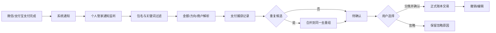

# 个人管家支付自动记账可行性调研

日期：2026-10-28  
目标应用：时间管家 / 个人管家 `0.11.0`（`versionCode 17`）  
调研范围：微信支付、支付宝支付完成后的自动发现、分类确认、入账，以及相关 GitHub 项目

## 一、结论

可以做，但应当把它理解为：

> **监听微信、支付宝发到通知栏的支付完成通知，先形成一条“待确认草稿”，再由用户选择分类并确认入账。**

这不是“登录用户的微信支付或支付宝，读取全部交易流水”。目前没有面向普通第三方应用的公开接口，可以直接获得某个自然人微信、支付宝账户的完整消费历史。微信支付和支付宝公开的订单查询、账单接口主要服务于商户自己的订单和账务，需要商户号、订单号、签名等业务身份，不能当成个人记账授权接口。

最稳妥的首版方案是：

1. 用户授予 Android“通知使用权”。
2. 只读取微信、支付宝等白名单应用的系统通知。
3. 从通知中提取支付成功、收入、退款等信息，形成本地待确认记录。
4. 用高优先级通知或应用内“待确认”收件箱让用户选分类。
5. 用户确认后才写入正式账本。
6. 通过来源、金额、商户、时间窗口去重，并保留撤销和忽略操作。

“支付完成后直接弹一个覆盖在微信/支付宝上面的悬浮窗”也能实现，但还需要“显示在其他应用上层”的特殊权限。Android 又限制了后台直接启动普通 Activity，所以悬浮窗只适合作为第二阶段增强，不应作为自动记账成立的前提。

## 二、当前个人管家项目边界

已检查当前代码：

- 应用版本为 `0.11.0`、`versionCode 17`、`minSdk 26`、`targetSdk 35`。
- 主 Room 数据库当前为版本 11，定义在 `app/src/main/java/com/timeagent/data/TimeAgentDatabase.kt`。
- 当前没有账本实体、交易实体、支付通知监听服务、无障碍服务或悬浮窗服务。
- 当前 Manifest 已有 `POST_NOTIFICATIONS`，它只允许个人管家发布自己的通知，不能用来读取其他应用的通知。
- 当前备份采用显式白名单，位于 `app/src/main/java/com/timeagent/backup/BackupSql.kt`。新增账本、支付草稿、规则等表后，必须同步修改备份捕获、校验、恢复和版本兼容逻辑，否则备份会因“存在未支持的用户数据表”拒绝生成。

因此，支付自动记账不能只加一个监听服务。它至少会同时改到：

```text
Room 数据模型与迁移
→ 账本领域模型和服务
→ 通知监听与解析
→ 待确认队列和用户界面
→ 去重/撤销
→ 备份与恢复
→ Manifest 权限和设置引导
```

## 三、GitHub 项目调研

星标数为 2026-10-28 查询的 GitHub 页面快照，会随时间变化。这里按“可借鉴价值”排序，不按星标多少简单排序。

| 项目 | 星标 | 许可证 | 主要价值 | 对个人管家的启发 |
|---|---:|---|---|---|
| [actualbudget/actual](https://github.com/actualbudget/actual) | 约 30k | MIT | 成熟的本地优先记账、预算、交易规则和导入体系 | 学习账本结构、规则命中、导入与人工复核；它并不是微信/支付宝直连方案 |
| [firefly-iii/firefly-iii](https://github.com/firefly-iii/firefly-iii) | 约 25k | AGPL-3.0 | 成熟的个人财务后台、账户、交易、规则、导入和核对 | 学习复杂交易与规则模型；服务端架构不适合直接搬进 Android MVP |
| [jameskokoska/Cashew](https://github.com/jameskokoska/Cashew) | 约 4.7k | GPL-3.0 | Flutter 移动端记账，分类、预算和交易编辑体验完整 | 学习移动端录入、编辑、汇总和撤销体验 |
| [mtotschnig/MyExpenses](https://github.com/mtotschnig/MyExpenses) | 约 1.2k | GPL-3.0 | Android 原生账本，导入、导出、账户与对账经验较多 | 学习 CSV/QIF 导入、账户核对和兼容性处理 |
| [AutoAccountingOrg/AutoAccounting](https://github.com/AutoAccountingOrg/AutoAccounting) | 961 | GPL-3.0 | 最接近目标的中文自动记账项目，包含通知、悬浮编辑、待确认和去重 | 流程参考价值最高；完整产品还涉及 Xposed、无障碍、Shizuku、Root、OCR，首版不应照搬 |
| [FuShengDuoBuYu/AutoBookKeepingBeta](https://github.com/FuShengDuoBuYu/AutoBookKeepingBeta) | 142 | MIT | 小体量但非常贴合：通知监听、支付宝/微信包名过滤、草稿、通知按钮选分类 | 最适合学习无 Root 的最小流程；代码质量和长期维护仍需自行验证 |

另外静态检查了 `MFTracker` 和 `ExpenseCC` 两个低星项目，只把它们作为通知监听和数据库结构旁证；它们对微信、支付宝实际模板的覆盖面证据不够强，因此没有列入主方案。补充检索还命中过 `Ayanamy000/jizhang`（3 星）、`zouyahui/monay`（2 星）、`huxu7755/Tally`（0 星）等中文项目，由于星标很低、源码证据或维护情况不足，也没有进入主表。

### 3.1 值得学的实现

#### AutoAccounting

检查版本：

- 提交：`ed5c2ad94b152f7351d76fcd33f9099a5f7532eb`
- 提交时间：2026-10-23
- 许可证：GPL-3.0

关键代码：

- `app/src/main/java/net/ankio/auto/service/NotificationService.kt`
  - 使用 `NotificationListenerService.onNotificationPosted()`。
  - 读取通知的标题、`EXTRA_BIG_TEXT` 和 `EXTRA_TEXT`。
  - 过滤来源应用和关键词。
  - 做通知内容哈希去重。
- `server/src/main/java/org/ezbook/server/db/model/BillInfoModel.kt`
  - 账单包含金额、币种、时间、商户、来源应用、去重组、状态、标签和备注。
  - 新账单默认进入 `Wait2Edit`，符合“先检测、再确认”的思路。
- `server/src/main/java/org/ezbook/server/tools/DuplicateDetector.kt`
  - 以金额、类型和前后时间窗口寻找重复候选，再合并成同一组。
- `app/src/main/java/net/ankio/auto/service/overlay/BillWindowManager.kt`
  - 有悬浮编辑及超时处理流程。

该项目适合学习“捕获 → 待编辑 → 分类确认 → 去重合并”的数据流。它不只依赖通知，阅读其 README 还能看到 Xposed、无障碍、Root、Shizuku、屏幕识别等更高权限路线。这些路线覆盖更广，但复杂度和隐私风险显著更高。

它的通知内容哈希表保存在监听服务内存中，进程重启后不能替代持久化去重。个人管家应把通知键和内容哈希落入数据库，否则进程被杀或设备重启后仍可能重复生成草稿。

#### AutoBookKeepingBeta

检查分支：

- `master`
- 提交：`bef698d16d942d1cdc06e49352d4bb71162f506c`
- 许可证：MIT

关键代码：

- `AutoBookKeeping/app/src/main/java/com/beta/autobookkeeping/service/NotificationReceiver.java`
  - 在 `onNotificationPosted()` 中接收通知。
- `AutoBookKeeping/app/src/main/java/Util/ProjectUtil.java`
  - 使用支付宝 `com.eg.android.AlipayGphone`、微信 `com.tencent.mm` 等包名白名单。
  - 内容去重窗口为 5 分钟，金额/支付方式/时间窗口去重为 2 分钟。
  - 明确注释：解析阶段只创建通知草稿，保存发生在详情确认阶段。
  - 发出“待确认”通知，并提供分类按钮、备注操作和撤销入口。
- `AutoBookKeeping/app/src/main/java/Util/NotificationBillParser.java`
  - 识别支付宝、微信来源。
  - 过滤待支付、失败、取消、验证码和登录等无关通知。
  - 提取金额、收支方向和退款语义。
- `AutoBookKeeping/app/src/main/AndroidManifest.xml`
  - 声明 `NotificationListenerService`，并绑定 `BIND_NOTIFICATION_LISTENER_SERVICE`。
  - 同时声明 `POST_NOTIFICATIONS`。

README 说明版本接入了云端 LLM；源码里仍保留了 LLM 解析函数，但当前通知监听实际调用的入口已经改为本地正则解析，旧的 LLM 入口只是兼容包装。对个人管家而言，建议首版只做本地解析：支付文本高度敏感，不能默认上传云端。

### 3.2 没有从这些项目里找到的“万能接口”

这些成熟项目主要解决账本、规则、导入、对账和分类，没有提供“用普通用户身份读取微信、支付宝全部消费流水”的公共接口。中文自动记账项目实际也主要依赖通知、无障碍、屏幕识别、Root/Xposed 或商户侧数据，而不是官方个人账本 API。

## 四、平台能力与限制

### 4.1 通知监听

Android 的 [`NotificationListenerService`](https://developer.android.com/reference/android/service/notification/NotificationListenerService) 可以让应用接收系统发布的通知。应用需要声明服务，用户还要在系统设置中单独授予“通知使用权”。

能读取到并不等于永远可靠：

- 用户关闭微信或支付宝通知后，个人管家收不到支付通知。
- 系统隐藏敏感通知内容时，可能只看到“你收到一条新消息”，无法提取金额。
- 应用可以调整通知标题、正文结构和文案，解析规则需要随版本修复。
- 应用内页面提示、横幅或声音不一定进入系统通知，覆盖范围取决于支付渠道和手机设置。

首版必须在目标手机上实测微信、支付宝的通知模板，而不是用网上截图推断。

### 4.2 个人管家自己的通知

`POST_NOTIFICATIONS` 只控制个人管家能否发出自己的通知。它和“通知使用权”是两项不同能力，不能互相替代。

建议用高优先级“待确认”通知承载分类按钮，并提供应用内待确认收件箱。它比悬浮窗稳定，也不会遮挡支付结果页面。

### 4.3 跨应用悬浮弹窗

悬浮窗需要 [`SYSTEM_ALERT_WINDOW`](https://developer.android.com/reference/android/Manifest.permission#SYSTEM_ALERT_WINDOW)：“显示在其他应用上层”权限。用户需要在系统设置中授权，部分 HyperOS 版本还会叠加后台弹出界面、电池优化和自启动限制。

另一个限制来自 Android 的后台 Activity 启动策略；参见 [Background activity launch restrictions](https://developer.android.com/guide/components/activities/background-starts)。支付 App 位于前台时，个人管家通常处于后台，不能假定能直接拉起 Activity。使用悬浮窗服务是更符合平台边界的做法，但仍会受厂商系统限制。

因此产品上建议分成两层：

- 基线：高优先级通知 + 分类按钮 + 应用内待确认列表。
- 增强：用户主动开启悬浮卡片，失败时自动退回基线通知。

### 4.4 微信支付和支付宝官方接口

官方公开接口适合商户处理自己产生的订单：

- [微信支付 v3 查询订单](https://pay.weixin.qq.com/doc/v3/merchant/4013070970)
- [微信支付 v3 查询订单号](https://pay.weixin.qq.com/doc/v3/merchant/4013070966)
- [支付宝 `alipay.trade.query`](https://opendocs.alipay.com/open/59da99d0_alipay.trade.query)

这些接口需要商户身份、商户订单号或平台订单号等条件。根据公开接口能力作判断：它们不能只凭用户授权就返回某个自然人账户的全部微信/支付宝消费流水。这是本次方案选择通知捕捉和用户确认的核心原因。

## 五、建议的数据设计

建议将“捕获到的支付事件”和“正式账本交易”分开存，避免误识别直接污染账本。



建议的最小表结构：

### `ledger_accounts`

- `id`
- `name`
- `type`：现金、银行卡、微信、支付宝、其他
- `currency`
- `openingBalanceMinor`
- `archivedAt`

### `ledger_categories`

- `id`
- `name`
- `direction`：支出、收入、退款、转账
- `icon`
- `sortOrder`
- `archivedAt`

### `payment_captures`

- `id`
- `sourcePackage`
- `sourceLabel`：微信、支付宝、银行等
- `notificationKey`
- `externalTransactionId`：通知里能可靠拿到时保存，拿不到则为空
- `occurredAt`
- `amountMinor`：使用整数分，避免浮点误差
- `direction`
- `merchant`
- `accountHint`
- `rawTextHash`
- `parsedJson`
- `parserVersion`
- `confidence`
- `dedupGroupId`
- `status`：`captured`、`parsed`、`needs_review`、`confirmed`、`ignored`、`superseded`
- `createdAt`
- `updatedAt`

### `ledger_transactions`

- `id`
- `accountId`
- `categoryId`
- `captureId`
- `amountMinor`
- `direction`
- `merchant`
- `note`
- `occurredAt`
- `confirmedAt`
- `version`
- `deletedAt`

重要的数据原则：

1. 通知捕获不等于正式账本记录。
2. 支付与退款分属不同方向。
3. 充值、提现、自己账户间转账默认不计入消费。
4. 分类不确定时进入待确认，不自动猜。
5. 原始通知正文不要写入日志；若必须留存用于排查，应先脱敏并限制保存时间。
6. `rawTextHash`、`sourcePackage + amountMinor + merchant + 时间窗口` 只用于去重，不能替代稳定的平台交易号。
7. 所有捕获和确认动作都要支持撤销，正式交易使用版本字段避免重复点击。

## 六、用户交互建议

首版交互可以这样设计：

1. 支付完成后，个人管家发出“待确认 · 支出 35.00 元”的高优先级通知。
2. 通知正文显示来源、时间、通知中识别出的商户。
3. 用户点常用分类按钮，或点“更多分类”进入个人管家选择页。
4. 确认后写入正式账本；也能选“这不是账单”“重复通知”“忽略”。
5. 应用内提供一个“支付待确认”收件箱，解决通知被划掉、点错或没来得及操作的问题。
6. 连续多笔支付排队处理，不覆盖上一条草稿。
7. 保存后提供撤销；撤销可以回到待确认状态。

悬浮卡片放在第二阶段。它可以显示：

```text
发现一笔支出  ¥35.00
支付宝 · 15:32 · 商户名

[餐饮] [交通] [购物] [更多]
[忽略]
```

用户没有开启悬浮权限、系统拦截、锁屏或前台应用不允许覆盖时，自动改用普通待确认通知。

## 七、开发顺序

### 阶段 0：通知模板实测

先只做诊断工具或最小监听 Demo，在目标手机验证：

- 微信扫码付款成功
- 微信线上支付成功
- 支付宝扫码付款成功
- 支付宝线上支付成功
- 退款
- 转账与收款
- 红包
- 自动扣款
- 待支付、失败、取消
- 锁屏、后台、省电模式
- 微信/支付宝通知关闭或隐藏敏感内容

输出每类通知的包名、标题、正文结构、是否含交易号、是否重复发送。模板不成立，就不应承诺自动记账覆盖率。

### 阶段 1：账本底座

- 账户、分类、正式交易和待确认捕获四类数据。
- 手动新增、编辑、删除、撤销。
- Room 迁移和 schema 测试。
- 备份白名单、恢复校验和旧版本兼容。
- 导出 CSV，先建立可迁移、可核对的闭环。

### 阶段 2：通知捕捉

- 添加 `NotificationListenerService` 和用户授权引导。
- 白名单只允许微信、支付宝及后续明确支持的应用。
- 在读取通知正文前先按包名过滤。
- 本地规则解析金额、方向、商户和交易号。
- 写入 `payment_captures`，不直接写正式账本。
- 5 分钟内容哈希去重和 2 分钟金额/来源/时间近似去重。

### 阶段 3：确认与通知按钮

- 待确认通知、应用内收件箱。
- 分类按钮、忽略、撤销。
- 多笔排队和重复合并。
- 锁屏及后台恢复。

### 阶段 4：可选悬浮窗

- 单独的悬浮窗服务。
- `SYSTEM_ALERT_WINDOW` 授权引导。
- 超过设定时间自动收起。
- 权限失效或厂商拦截时回退到通知。
- 绝不抢占用户正在看的支付确认页面。

### 阶段 5：漏单兜底

- 微信/支付宝账单 CSV 导入。
- 导入时与已确认交易对账。
- 未匹配交易进入待确认，不重复入账。

## 八、验收标准

首版达到以下条件再判断“可用”：

- 同一笔微信或支付宝通知重复发送多次，只保留一条草稿。
- 微信与支付宝各至少覆盖 5 个真实支付场景，连续跑 20 笔无崩漏和重复。
- 应用在后台、锁屏、重启后仍能接收已授权来源的通知。
- 用户不选分类时不会自动写入正式交易。
- 选分类、保存、撤销、忽略都有自动化测试。
- 关闭个人管家通知权限、关闭通知使用权或隐藏敏感通知时，界面能明确说明原因并给出手动补录入口。
- 新增数据表后，备份生成、校验、恢复和旧版本拒绝逻辑全部通过。
- 悬浮窗未授权或被系统拦截时，普通待确认通知仍能工作。

仍不能承诺的边界：

- 所有支付方式都能自动识别。
- 一定能从通知拿到商户名或平台交易号。
- 所有 HyperOS 版本都能稳定悬浮。
- 关闭微信/支付宝通知后仍能捕获。
- 第三方应用可以读取个人账户的完整微信/支付宝流水。

## 九、许可证与隐私

- Actual 为 MIT；可以按其许可证约定复用。
- AutoBookKeepingBeta 为 MIT；复用代码时需保留版权和许可声明。
- Firefly III 为 AGPL-3.0，AutoAccounting、Cashew、MyExpenses 为 GPL 系许可证。直接复制其代码会带来开源义务，建议只学习模型和交互，不把源码直接塞进个人管家。
- 通知使用权能看到个人管家的白名单之外的通知。实现时应在 `onNotificationPosted()` 的第一步检查 `sbn.packageName`，未命中立即返回。
- 原始通知可能包含验证码、聊天、银行账号或支付信息。首版默认只在本机处理，不记录原文日志，不上传云端 LLM。
- 分类按钮和捕获草稿应避免在锁屏通知上公开敏感备注；默认只显示必要金额、来源和时间，并提供“隐藏金额”设置。

## 十、最终建议

值得做，而且与该个人管家“减少手动操作，但保留用户确认”的方向一致。首版不要追求“支付平台直连”，也不要一开始做无障碍或 Root 自动识别。

最合适的切入点是：

> **本地账本底座 + 微信/支付宝通知白名单监听 + 待确认草稿 + 分类确认 + 去重/撤销 + 备份恢复。**

完成这套闭环后，再加悬浮窗、CSV 对账和更多支付来源。这样每一步都能单独验收，也能在某个平台改通知格式时把影响限制在解析器，而不是把错误交易直接写进正式账本。

## 参考来源

### 一手平台文档

- Android NotificationListenerService：<https://developer.android.com/reference/android/service/notification/NotificationListenerService>
- Android `SYSTEM_ALERT_WINDOW`：<https://developer.android.com/reference/android/Manifest.permission#SYSTEM_ALERT_WINDOW>
- Android notifications runtime permission：<https://developer.android.com/develop/ui/views/notifications/notification-permission>
- Android background activity launch restrictions：<https://developer.android.com/guide/components/activities/background-starts>
- 微信支付 v3 查询订单：<https://pay.weixin.qq.com/doc/v3/merchant/4013070970>
- 微信支付 v3 查询订单号：<https://pay.weixin.qq.com/doc/v3/merchant/4013070966>
- 支付宝 `alipay.trade.query`：<https://opendocs.alipay.com/open/59da99d0_alipay.trade.query>

### GitHub 项目

- <https://github.com/actualbudget/actual>
- <https://github.com/firefly-iii/firefly-iii>
- <https://github.com/jameskokoska/Cashew>
- <https://github.com/mtotschnig/MyExpenses>
- <https://github.com/AutoAccountingOrg/AutoAccounting>
- <https://github.com/FuShengDuoBuYu/AutoBookKeepingBeta>

### 本地代码检查

- `app/src/main/java/com/timeagent/data/TimeAgentDatabase.kt`
- `app/src/main/java/com/timeagent/backup/BackupSql.kt`
- `app/src/main/AndroidManifest.xml`
- AutoAccounting 本地快照：本机临时研究目录（未纳入本仓库）
- AutoBookKeepingBeta 本地快照：本机临时研究目录（未纳入本仓库）

### 证据边界

- “GitHub 项目具备相应结构”来自静态源码检查，不代表已在目标手机完成真实支付回归。
- Android 和支付平台能力来自官方公开文档。
- “个人管家能在微信、支付宝中稳定捕获哪些通知”仍必须在 Redmi K70 Ultra / HyperOS 实机上逐类验证。
